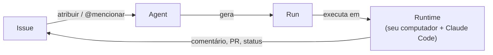

# Curiosidade — Orquestração e Observabilidade: Medindo as Duas Pontas do Ciclo

!!! info "Conteúdo extra — sem entrega e sem nota"
    Esta página faz parte das [Curiosidades](index.md): conteúdo para quem quer ir além do programa. **Não é aula do cronograma, não tem entregável, não vale nota e não entra em nenhum checkpoint.**

    O Multica, porém, é a ferramenta da [tarefa de casa da Aula 14](../plano-de-aula/aulas/aula-14-2026-11-23.md#tarefa-de-casa-passo-a-passo). Se for fazê-la, comece pelo [exemplo guiado de TODO List](#exemplo-guiado-todo-list-com-multica-individual).

[⬇️ Baixar / Copiar Código Fonte](https://raw.githubusercontent.com/paulossjunior/aula-extensao/main/docs/curiosidades/orquestracao-e-observabilidade.md)

---

## Introdução

Nas aulas do curso trabalhamos com **um agente por vez**: você abre o terminal, descreve, ele executa, você revisa. Funciona bem para tarefas com um único fio condutor. Começa a travar quando o trabalho tem frentes distintas — implementar, revisar, coordenar, verificar — e quando o agente só anda enquanto você está na conversa.

O **[Multica](https://multica.ai)** propõe outra posição para o agente: em vez de ferramenta que você opera, um **colega de equipe**. O agente recebe issue, comenta, abre pull request, pede revisão a outro agente e avisa você no Inbox quando termina. Pessoas e agentes trabalham no mesmo quadro, com o mesmo vocabulário — issue, menção, revisão, merge. É a divisão de trabalho que vocês aplicaram no Scrum da EaD 07, só que parte dos executores são agentes.

E aqui vem o ponto que vale a aula inteira: **orquestrar mais agentes é uma aposta em velocidade**. O framework PSM CID, que vimos na Aula 01, é explícito ao dizer que ênfase excessiva em velocidade cobra o preço em qualidade. Então não basta montar a equipe de agentes: é preciso **medir se ela realmente acelerou e se a qualidade se manteve**.

Por isso esta página tem duas metades, e elas são a mesma coisa vista de dois lados. Olhem de novo o [Diagrama de Contexto de Medição da Aula 01](../explicacoes/psm-cid.md#contexto-de-medicao-onde-cada-medida-nasce):

- A **primeira metade** é sobre a *Factory* — construir mais rápido com uma squad de agentes no Multica, e provar que a qualidade se manteve.
- A **segunda metade** é sobre *Operations* — o que acontece com o produto depois do deploy, e como o grupo fica sabendo.

Ao final, você sabe **explicar os conceitos do Multica — workspace, agente, runtime, run, skill e squad —, conduzir uma issue do pedido ao merge com agentes que implementam e revisam, e decidir com medida se a orquestração ajudou o produto do grupo**.

O conteúdo cobre a **Fase 4 do ciclo** — operar e monitorar — do ponto de vista de quem quer aprofundar.

---

## Materiais de Apoio

- [Sobre o Multica](../explicacoes/multica.md) — os conceitos, como se relacionam e o que muda em relação ao CrewAI
- [Referência — Multica](../referencia/multica.md) — instalação, comandos da CLI, campos do agente, limites do runtime
- [Complete tutorial](https://multica.ai/docs/tutorial) — o tutorial oficial que a aula segue como exemplo

---

## Discovery do Projeto

### O que é o Multica

| Item | Valor |
|------|-------|
| Descrição | Plataforma open-source para pessoas e agentes de IA trabalharem como uma equipe |
| Linguagem | Go |
| Onde roda | Nuvem do Multica ou servidor próprio (*self-hosted*) |
| Quem executa o código | As ferramentas de IA que você já usa — Claude Code, Codex, Copilot CLI e outras — no seu computador |
| Site e documentação | [multica.ai](https://multica.ai) · [multica.ai/docs](https://multica.ai/docs) · [repositório](https://github.com/multica-ai/multica) |

A diferença para tudo que vimos até agora: o Multica **não substitui** o Claude Code ou o Codex. Ele os **coloca para trabalhar dentro de um quadro de issues**, com papéis, revisão e histórico.

---

### Os conceitos em uma frase cada

| Conceito | Em uma frase |
|----------|--------------|
| **Workspace** | O espaço da equipe — tudo vive dentro dele |
| **Issue** | Uma unidade de trabalho, com status e histórico. Pode ser atribuída a pessoa, agente ou squad |
| **Agent** | Uma **configuração**: nome, instruções, modelo, skills e runtime. Não é um processo rodando |
| **Runtime** | Onde o agente executa: um computador + uma ferramenta de IA instalada nele |
| **Daemon** | O processo do Multica no seu computador, que pega o trabalho e devolve o resultado |
| **Run** | Uma execução concreta. Cada acionamento gera um run |
| **Skill** | Um "como fazer" reutilizável (`SKILL.md`) anexado a um ou mais agentes |
| **Squad** | Agentes e pessoas sob um agente líder que coordena |
| **Autopilot** | Aciona agentes por agenda ou evento |

O fluxo inteiro cabe numa linha: **atribuir, mencionar, conversar ou agendar aciona um agente → gera um run → o run executa num runtime → o resultado volta para a issue**.



!!! abstract "Três distinções que derrubam a maioria das dúvidas"
    - **Agente é identidade, runtime é máquina.** O *Engineer* assina o trabalho; o seu notebook executa. Notebook desligado = runtime *Offline*, e o agente fica sem onde rodar.
    - **Agente só executa quando acionado.** Ele não fica "ligado" esperando trabalho.
    - **Run concluído não é issue concluída.** Uma issue gera vários runs — implementar, corrigir, fazer merge. Quem diz onde o trabalho está é o status da issue.

    O porquê de cada uma está em [Sobre o Multica](../explicacoes/multica.md#tres-distincoes-que-evitam-confusao).

---

### O tutorial oficial, como exemplo

A documentação do Multica tem um [tutorial completo](https://multica.ai/docs/tutorial) que parte de um workspace vazio e constrói o **site de portfólio de um fotógrafo**. Ele é o melhor exemplo do curso para ver cada conceito em uso, porque cada passo introduz exatamente um deles.

| Passo do tutorial | O que acontece | Conceito que aparece |
|-------------------|----------------|----------------------|
| 1. Criar workspace | Nome, URL e prefixo `SITE` — as issues viram `SITE-1`, `SITE-2`… | **Workspace** |
| 2. Conectar o computador | O Desktop sobe o daemon e detecta Claude Code/Codex. Em *Team → Runtimes*, o computador aparece *Online* | **Daemon**, **Runtime** |
| 3. Criar o *Multica helper* | Primeiro agente, pela interface: cuida de configurar o workspace, **não toca em código** | **Agent** |
| 4. Criar o *Engineer* pelo chat | Você pede ao helper, e **ele cria o agente** usando a CLI do Multica | **Chat**, agente que configura agente |
| 5. Preparar o repositório | Engineer cria o repositório e roda `multica repo add`; em *Settings → Code* conecta o GitHub | Integração com PR |
| 6. Primeira issue, `SITE-1` | Pedido escrito em linguagem natural, *Created by: Engineer*. Status vai para *In Progress* sozinho | **Issue**, **Run** |
| 7. Pré-visualizar | Engineer termina, move para *In Review*, avisa no Inbox. O ambiente sobe com `multica env start web` | **Inbox**, ambiente |
| 8. Feedback vira regra | Você pede e o Engineer atualiza as **próprias instruções** com `multica agent update` | Instruções versionadas |
| 9–10. *Reviewer* e o laço de correção | Reviewer, em **outra ferramenta** (Codex), só lê: aponta cinco problemas com arquivo e linha. `@Engineer` corrige, `@Reviewer` confere | Revisão entre agentes |
| 11. Merge | Engineer faz merge, o PR aparece *Merged*, `SITE-1` vai para *Done* | Fechamento do ciclo |
| 12–13. Squad *Website Team* | Lead + Engineer + Reviewer + você na aprovação final. Skills `tdd` no Engineer e `delivery-brief` no Lead | **Squad**, **Skill** |
| 14. `SITE-2` para a squad | Lead delega, Engineer escreve o teste primeiro, Reviewer aprova, Lead **espera a sua aprovação** para o merge | Coordenação |
| 15. Autopilot semanal | Toda segunda às 9h (`0 9 * * 1`), o Reviewer abre uma issue de saúde do código | **Autopilot** |

!!! example "Repare no desenho dos papéis"
    O tutorial não cria três agentes iguais. Cada um tem um **limite** escrito nas instruções: o helper não toca em código, o Reviewer nunca modifica código, o Lead nunca faz merge sem aprovação humana. **O que o agente está proibido de fazer é tão importante quanto o que ele faz** — é a mesma lógica da constitution do Spec-Kit da Aula 09.

!!! abstract "Onde isso já apareceu no curso"
    - O laço **Engineer → Reviewer → Engineer** é o code review do GitFlow da Aula 07, com agentes dos dois lados.
    - A skill `tdd` ("escreva o teste que falha primeiro") é o critério de aceitação do Gherkin da Aula 13 virando comportamento do agente.
    - O pedido da `SITE-1` define o que caracteriza o trabalho pronto. Spec ruim gera código ruim, com um agente ou com cinco.

---

### Por que isso é diferente de abrir o Claude Code

| | Agente no terminal | Agente no Multica |
|---|---|---|
| Quem aciona | Você, na conversa | Issue, menção, chat ou agenda |
| Onde fica o histórico | Na sessão, que se perde | Na issue: comentários, runs, transcript, PR |
| Revisão | Você lê o diff | Outro agente revisa, você aprova |
| Paralelismo | Uma conversa por vez | Vários runs ao mesmo tempo — até 6 por agente, 20 por daemon |
| Status do trabalho | Na sua cabeça | *In Progress → In Review → Done*, visível para o grupo |

A última linha é a que importa para a segunda metade da aula: **status registrado é medida de graça**.

---

### Quando usar — e quando não

!!! warning "O erro clássico: orquestrar cedo demais"
    Montar uma squad de quatro agentes para uma tarefa que um agente resolve adiciona custo, espera e pontos de falha — sem ganho. Antes de criar uma squad, responda: **quais frentes deste trabalho são realmente independentes?**

    Vocês já têm a ferramenta para responder isso: a **DSM da EaD 07**. Tarefas sem dependência entre si são candidatas a rodar em paralelo; tarefas encadeadas não ganham nada com orquestração.

!!! danger "Dois cuidados antes de adotar"
    - **Variáveis de ambiente do agente ficam em texto puro** no servidor. Segredo de produção não vai ali.
    - **Skills importadas não são revisadas nem isoladas**, e rodam com acesso ao seu computador. Leia o `SKILL.md` antes de anexar.

---

### Medindo a orquestração com o PSM CID

Esta é a parte que fecha a primeira metade. Multiagente é uma **aposta de velocidade na Factory** — a região do [Diagrama de Contexto de Medição (Figura 2 da Aula 01)](../explicacoes/psm-cid.md#contexto-de-medicao-onde-cada-medida-nasce) que vai do backlog ao deploy. Toda aposta de velocidade precisa de contraprova de qualidade.

A vantagem do Multica aqui é que boa parte dos números **já está registrada** na issue: as transições de status, os runs, os comentários do revisor.

| Medida do PSM CID | O que ela responde sobre a sua squad | Onde ler no Multica |
|-------------------|--------------------------------------|---------------------|
| **Cycle Time** | A squad realmente encurtou o tempo, ou só distribuiu a espera? | Tempo entre *In Progress* e *Done* |
| **Lead Time** | Da identificação do trabalho até a entrega — inclui configurar agentes e squad | Criação da issue até *Done* |
| **Cumulative Flow** | O trabalho flui, ou empilha esperando aprovação humana em *In Review*? | Quantas issues em cada status, ao longo dos dias |
| **Committed vs. Completed** | A squad entregou o que se comprometeu? | Issues criadas × issues em *Done* |
| **Defect Detection** | Quantos defeitos foram **contidos** antes da release e quantos **escaparam** | Achados do Reviewer (contidos) × bugs abertos depois do merge (escapados) |
| **Automated Test Coverage** | A trava que segura a qualidade quando a geração de código acelera | Checks de CI no card do PR |

!!! danger "O ponto de equilíbrio velocidade × qualidade"
    A [Figura 8 da Aula 01](../explicacoes/psm-cid.md#principios-de-medicao) mostra o *sweet spot*: ênfase excessiva em velocidade custa qualidade do produto; ênfase excessiva em qualidade derruba a entrega. **Multiagente empurra o cursor para o lado da velocidade.**

    Se a sua squad triplicou a produção de código e dobrou os defeitos escapados, ela **piorou** o produto. Sem medir, o time não tem como saber de que lado do ponto de equilíbrio está.

O framework também observa que algumas melhorias — **automação, principalmente** — deslocam as duas curvas ao mesmo tempo. É o que o tutorial faz ao anexar a skill `tdd` ao Engineer e colocar um Reviewer que nunca escreve código: uma squad que gera código **e testes, e revisa** é diferente de uma que só gera código.

---

### Observabilidade: colocar o produto sob observação

A squad mede o que acontece **antes** do deploy. Falta a outra ponta: o produto já está no ar, sendo usado — e ninguém do grupo está olhando para ele.

Na Aula 01 definimos as quatro perguntas que um software em produção precisa responder continuamente. Agora elas viram instrumentação concreta:

| Pergunta | Como se instrumenta | Medida do PSM CID |
|----------|---------------------|-------------------|
| Está no ar? | *Health check* — uma rota `/health` que responde 200 e é consultada de fora | Environment Reliability |
| Está quebrando? | **Log estruturado** de erro, com nível, timestamp e identificador de requisição | Defect Detection |
| Está sendo usado? | Contador por funcionalidade: quantas vezes foi acionada, por quantas pessoas | Product Value |
| Está resolvendo? | Os indicadores que o grupo definiu no PRD, medidos no produto real | Product Value |

#### Monitorar não é ter log — é ser avisado

A diferença entre um produto observado e um produto com logs é **quem toma a iniciativa**. Log guardado num servidor que ninguém abre não é observabilidade: é arquivo morto.

```text
Falha ocorre  →  Detecção  →  Diagnóstico  →  Correção  →  Serviço restaurado
              └──── MTTD ────┘
              └──────────────── MTTR ─────────────────────┘
```

- **MTTD** — *Mean Time to Detect*: quanto tempo entre a falha acontecer e alguém saber
- **MTTR** — *Mean Time to Restore*: quanto tempo entre a falha e o serviço voltar
- **Change Failure Rate** — que proporção dos deploys precisou de *rollback*

!!! danger "O MTTD que protege a nota do grupo"
    Os 50 pontos exigem **produto validado e em produção**. Se o sistema cai numa sexta e o grupo descobre na apresentação de segunda, o MTTD é de três dias — e por três dias não houve produto em produção.

    Um alerta automático derruba esse número de dias para minutos. É a diferença entre **afirmar** que o produto está no ar e **saber** que está.

#### O mínimo viável de observabilidade

Para o escopo deste curso, três peças bastam e cabem numa tarde:

1. **Uma rota de health check** no produto, que responda 200 quando o sistema está sadio
2. **Log estruturado de erro** — em vez de `print`, uma linha por evento com nível, momento e contexto
3. **Um verificador externo agendado** que consulta o health check e **avisa o grupo num canal** quando algo sai do esperado

A terceira peça é a que fecha o ciclo. Pode ser um *cron* num servidor, uma GitHub Action agendada, um serviço de *uptime* gratuito, ou um agente que roda periodicamente — um Autopilot do Multica, por exemplo, ou o Hermes da [Aula 16](../plano-de-aula/aulas/aula-16-2026-12-07.md), que mostra essa alternativa em detalhe. O que importa não é a ferramenta: é **existir alguém ou algo que olhe sem depender de lembrança humana**.

!!! warning "Autopilot roda no seu runtime"
    Um Autopilot do Multica executa no runtime do agente — o computador de alguém do grupo. Se esse computador estiver desligado, o runtime fica *Offline* e a verificação não acontece. Para monitorar produção, o verificador precisa morar numa máquina que fica ligada.

!!! tip "O princípio do PSM CID por trás disso"
    Entre os princípios de medição do framework está: *"a coleta de medidas deve ser automatizada na medida do praticável e integrada ao fluxo de trabalho"*. Medida que depende de alguém lembrar de conferir não sobrevive a um semestre.

---

## Exercícios para Explorar

!!! info "Opcional do começo ao fim"
    Nada aqui é entregável. O que os exercícios deixam é decisão informada: se vale adotar uma squad de agentes no produto de vocês, e o que o produto precisa ter para ser considerado observado.

### Exemplo Guiado — TODO List com Multica (individual)

**Duração estimada:** 60 a 90 min
**Formato:** Individual, na sua máquina · sem entrega

Antes de levar o Multica para o produto do grupo, faça o ciclo inteiro **sozinho** num projeto pequeno: a **ListaJá**, a mesma TODO List do [Exemplo de TODO List usando Caveman](../modelos/caveman-exemplo-todo-list.md). É o [tutorial oficial](https://multica.ai/docs/tutorial) em escala reduzida — dois agentes, três issues, um repositório — e serve para você ver cada conceito acontecer antes de precisar explicá-lo.

| Campo | Valor |
|-------|-------|
| Produto | ListaJá — TODO List simples |
| Stack | React + Vite + TypeScript, tarefas salvas no `localStorage` |
| Agentes | **Engineer** (implementa) e **Reviewer** (só revisa) |
| Prefixo das issues | `TODO` — as issues viram `TODO-1`, `TODO-2`, `TODO-3` |
| Pré-requisitos | Conta no Multica, Claude Code ou Codex com login feito, Node.js, conta no GitHub. O [GitHub CLI](https://cli.github.com/) (`gh`) é opcional |

#### Passo 1 — Workspace e runtime

1. Crie um workspace **pessoal**, com o prefixo `TODO`.
2. Instale o [Multica Desktop](https://multica.ai/download) ou a [CLI](../referencia/multica.md#instalacao).
3. Em *Team → Runtimes*, confira que o seu computador aparece **Online** e que a ferramenta de IA foi detectada.

**Conceitos em jogo:** workspace, daemon, runtime.

#### Passo 2 — Os dois agentes

Crie os agentes em *Team → +*. Escolha o runtime do seu computador e deixe o acesso em *Only me*.

**Engineer** — instruções:

```text
Você implementa a ListaJá, uma TODO List em React + Vite + TypeScript.
- Trabalhe só na issue atribuída. Não implemente nada fora do pedido.
- Todo PR leva o ID da issue no título, por exemplo "TODO-1: ...".
- Cada critério de aceitação da issue vira um teste ou uma checagem manual descrita no PR.
- Ao terminar, mova a issue para In Review e resuma o que fez em um comentário.
- Se o pedido for ambíguo, pergunte no comentário antes de codar.
```

**Reviewer** — instruções:

```text
Você revisa PRs da ListaJá. Você NUNCA modifica código.
- Compare o diff com os critérios de aceitação da issue.
- Cada achado leva arquivo, linha e o motivo.
- Rode só verificações de leitura: build, lint, testes.
- Termine com um veredito: "Changes requested" ou "Ready to merge".
```

Se tiver duas ferramentas instaladas, coloque o Reviewer na outra — por exemplo, Engineer no Claude Code e Reviewer no Codex. Um modelo revisando o trabalho de outro pega erros que ele mesmo não pegaria.

**Conceitos em jogo:** agent como configuração; o **limite** de cada papel escrito nas instruções.

#### Passo 3 — Repositório

No *Chat*, selecione o Engineer e peça:

```text
Crie um repositório público no GitHub chamado listaja-multica,
registre no workspace com `multica repo add` e me devolva a URL.
```

Sem o `gh`, crie o repositório no GitHub à mão e registre em *Settings → Code → Add repository*. Em seguida, clique em **Connect GitHub** na mesma página, para os PRs aparecerem na issue.

**Conceitos em jogo:** chat — cada mensagem é um run.

#### Passo 4 — `TODO-1`: criar e listar tarefas

Aperte `C`, escolha **Engineer** em *Created by* e escreva o pedido:

```text
Inicialize a ListaJá com:
npm create vite@latest listaja -- --template react-ts

Depois implemente:
Como usuário, quero adicionar tarefas e vê-las numa lista, para lembrar o que preciso fazer.

Critérios de aceitação:
Cenário: adicionar tarefa válida
  Dado que a lista está vazia
  Quando eu digito "Estudar Multica" e confirmo
  Então a lista mostra "Estudar Multica" como pendente

Cenário: recusar título vazio
  Dado que o campo está vazio
  Quando eu confirmo
  Então nenhuma tarefa é criada e aparece uma mensagem de erro

Cenário: manter as tarefas ao recarregar
  Dado que existe a tarefa "Estudar Multica"
  Quando eu recarrego a página
  Então a tarefa continua na lista

Abra um PR com o título "TODO-1: ..." .
```

Repare no que acontece sozinho: a issue vai para **In Progress**, o selo *Engineer is working* aparece, e o *Execution log* mostra o run. Abra **View transcript** e acompanhe os passos do agente.

**Conceitos em jogo:** issue, run, status.

#### Passo 5 — Revisão e laço de correção

Quando o Engineer mover `TODO-1` para **In Review** e avisar no Inbox:

1. No comentário da issue, escreva `@Reviewer revise o PR desta issue contra os três cenários`.
2. Se vier *Changes requested*, responda no mesmo fio: `@Engineer resolva os achados do Reviewer, um por um`.
3. Chame `@Reviewer` de novo. Repita até o veredito *Ready to merge*.
4. Peça: `@Engineer faça o merge do PR e feche a issue`. Confira `TODO-1` em **Done**.

**Conceitos em jogo:** menção aciona agente; um run concluído não fecha a issue — o merge, sim.

#### Passo 6 — `TODO-2` e `TODO-3`

Repita os passos 4 e 5 com duas issues novas:

| Issue | Pedido |
|-------|--------|
| `TODO-2` | Como usuário, quero **concluir, editar e remover** tarefas. Escreva um cenário Gherkin para cada ação |
| `TODO-3` | **Bug:** se o `localStorage` tiver um JSON inválido, a aplicação quebra ao abrir. Esperado: abrir com a lista vazia e registrar o erro no console. Escreva o teste que reproduz o bug **antes** de corrigir |

O `TODO-3` é o mesmo bug apontado na revisão do [exemplo com Caveman](../modelos/caveman-exemplo-todo-list.md) — compare como cada fluxo chegou nele.

#### Passo 7 — Feedback vira regra

Toda correção que você repetiu duas vezes vira instrução. No *Chat* com o Engineer:

```text
Atualize as suas próprias instruções com `multica agent update`:
<a regra que você teve de repetir — por exemplo, "rode o lint antes de abrir o PR">
```

Abra *Team → All agents → Engineer* e confira a regra nova.

**Conceitos em jogo:** instruções enviadas em todo run — agente que não aprende com o feedback erra igual na próxima issue.

#### Passo 8 — Medir

Preencha com o que a própria issue registrou:

| Issue | Cycle Time (*In Progress* → *Done*) | Achados do Reviewer (defeitos contidos) | Runs de correção | Defeitos achados depois do merge (escapados) |
|-------|------|------|------|------|
| `TODO-1` | | | | |
| `TODO-2` | | | | |
| `TODO-3` | | | | |

E responda para você mesmo:

- Quanto tempo cada issue ficou parada em **In Review** esperando **você**?
- O Reviewer pegou algo que você não teria pegado?
- Se fizesse a ListaJá sozinho, no terminal, teria sido mais rápido? Com mais ou menos defeitos?

**O que fica:** um repositório `listaja-multica` com três PRs revisados e mergeados, três issues em *Done*, um Engineer com uma regra a mais nas instruções e a tabela acima preenchida.

!!! tip "Depois do exemplo, o produto do grupo"
    Com o ciclo feito uma vez sozinho, o Exercício 1 repete o mesmo caminho no produto real do grupo — agora com mais gente, mais agentes e um backlog de verdade.

---

### Exercício 1 — Do Workspace Vazio ao Primeiro Merge

**Duração estimada:** 25 min
**Formato:** Individual ou em grupo, na máquina

Seguimos os passos 1 a 11 do [tutorial oficial](https://multica.ai/docs/tutorial), trocando o portfólio pelo **produto do grupo**. Pré-requisito: Claude Code ou Codex instalado e com login feito — veja os [requisitos](../referencia/multica.md#requisitos).

1. **Workspace** — criem o workspace com o prefixo do grupo. A URL não muda depois; o prefixo muda.
2. **Runtime** — instalem o [Multica Desktop](https://multica.ai/download) ou a [CLI](../referencia/multica.md#instalacao). Em *Team → Runtimes*, confiram que o computador aparece **Online** e que a ferramenta foi detectada.
3. **Agente helper** — criem pela interface um agente que **só configura o workspace e nunca toca em código**. Escrevam esse limite nas instruções.
4. **Agente Engineer** — no *Chat*, peçam ao helper que crie o Engineer. Depois abram *Team → All agents → Engineer* e **leiam as instruções que o helper escreveu**: é o momento de corrigir o que ficou vago.
5. **Repositório** — registrem o repositório do grupo (`multica repo add` ou *Settings → Code → Add repository*) e conectem o GitHub.
6. **Issue** — com `C`, criem uma issue pequena e real do backlog, *Created by: Engineer*. Acompanhem o run em *Execution log → View transcript*.
7. **Reviewer** — criem um terceiro agente **só de leitura**, se possível em outra ferramenta. Na issue, mencionem `@Reviewer` pedindo a revisão do PR. Repitam `@Engineer` / `@Reviewer` até o veredito *Ready to merge*.
8. **Merge** — peçam o merge ao Engineer e confiram a issue em *Done*.

!!! tip "O passo que mais se pula, e mais importa"
    No passo 8 do tutorial, o feedback de vocês vira regra nas instruções do próprio agente (`multica agent update`). Toda correção que vocês repetirem duas vezes deveria virar instrução — senão o agente erra igual na próxima issue.

**O que fica:** Uma issue do produto em *Done*, com PR revisado por agente e o transcript dos runs.

---

### Exercício 2 — Desenhar a Squad com a DSM

**Duração estimada:** 10 min
**Formato:** Grupos

Peguem a **DSM do grupo**, da EaD 07, e respondam:

1. Quais tarefas do produto **não têm dependência** entre si?
2. Dessas, quais justificam um agente com papel próprio? Qual o **limite** de cada papel — o que ele está proibido de fazer?
3. Qual trabalho é rotina conhecida e periódica — ou seja, deveria ser **Autopilot** e não issue atribuída à mão?
4. Que **skill** cada papel precisa? Já existe uma em `.agents/skills/` do repositório que sirva?
5. Em que ponto **uma pessoa do grupo** precisa aprovar antes de seguir?

**O que fica:** Desenho da squad do grupo — líder, papéis, limites, skills e o ponto de aprovação humana — justificado pela DSM.

---

### Exercício 3 — Medir Antes e Depois

**Duração estimada:** 20 min
**Formato:** Grupos

O exercício central desta página. Peguem a **user story que o grupo implementou na tarefa de casa da [Aula 13](../plano-de-aula/aulas/aula-13-2026-11-16.md)** — ou outra tarefa real do backlog — e executem duas vezes:

| | Execução A — agente único no terminal | Execução B — squad no Multica |
|---|---|---|
| **Cycle Time** | tempo do início até concluir | *In Progress* → *Done* |
| **Defeitos contidos** | encontrados antes de integrar | achados do Reviewer antes do merge |
| **Defeitos escapados** | encontrados depois | encontrados depois do merge |
| **Retrabalho** | precisou refazer? quanto? | quantos runs de correção? |

Depois respondam, por escrito:

- A squad reduziu o **Cycle Time**? Contando o tempo de configurar agentes e squad, o saldo ainda é positivo?
- A issue ficou parada em *In Review* esperando vocês? Quanto tempo?
- A razão entre defeitos escapados e total **piorou**?
- De que lado do ponto de equilíbrio velocidade × qualidade o grupo ficou?

!!! tip "Resultado negativo também é resultado"
    Se a squad foi mais lenta ou gerou mais defeitos, isso é uma **descoberta válida e defensável** — e provavelmente indica que a tarefa não tinha frentes independentes. Registre e justifique. O que não vale é adotar orquestração sem evidência.

**O que fica:** Tabela comparativa preenchida com as conclusões do grupo.

---

### Exercício 4 — Colocar o Produto Sob Observação

**Duração estimada:** 20 min
**Formato:** Grupos

O produto do grupo já está no ar. Falta saber quando ele deixa de estar.

1. **Health check** — garantam uma rota que responda 200 quando o sistema está sadio. Se já existe, confiram o que ela realmente verifica: responder 200 com o banco fora do ar é pior que não ter rota nenhuma.
2. **Log de erro** — troquem uma saída solta por um log estruturado, com nível, momento e contexto suficiente para diagnosticar sem reproduzir.
3. **Verificador externo agendado** — configurem algo que consulte o health check periodicamente e **avise o grupo num canal** quando falhar. Cron, GitHub Action agendada, serviço de uptime ou agente: escolha do grupo.
4. **Meçam o MTTD real** — derrubem o produto de propósito e cronometrem: quanto tempo até o alerta chegar?

| O que medir | Valor do grupo |
|-------------|----------------|
| MTTD medido (falha → alerta) | |
| Frequência da verificação | |
| Canal de alerta | |
| O que o health check verifica de fato | |

!!! warning "Health check que sempre responde 200 não serve"
    Rota que devolve `{"status":"ok"}` sem checar nada dá falsa segurança: o produto cai, o monitor diz que está tudo bem, e o MTTD volta a ser de dias. O health check precisa tocar as dependências críticas — banco, fila, serviço externo.

**O que fica:** Tabela preenchida com o MTTD medido, mais o print do alerta recebido.

---

## 🏆 Para Ir Além — Refazer em CrewAI

**Formato:** Leitura e experimento livre · sem entrega

Uma ferramenta só se entende de verdade quando você tem outra para comparar. O Multica é uma **plataforma**: orquestra ferramentas de código que já existem, em volta de issues e PRs. O **[CrewAI](https://github.com/crewAIInc/crewAI)** é um **framework Python**: você escreve a equipe de agentes em código e YAML. A sugestão é **reconstruir no CrewAI a mesma equipe do Exercício 1** e comparar.

| Item | Valor |
|------|-------|
| Repositório | [crewAIInc/crewAI](https://github.com/crewAIInc/crewAI) |
| Licença | MIT |
| Linguagem | Python (>=3.10, <3.14) |
| Documentação | [docs.crewai.com](https://docs.crewai.com) |

O ponto de partida:

```bash
uv pip install crewai
uv pip install 'crewai[tools]'      # com as ferramentas extras

crewai create crew meu-projeto
```

O comando gera `config/agents.yaml` (cada agente com `role`, `goal` e `backstory`) e `config/tasks.yaml` (cada tarefa com `description`, `expected_output` e o agente responsável). O `Process` define se as tarefas rodam em sequência ou sob um gerente — o análogo do líder da squad. A comparação conceitual está em [Sobre o Multica](../explicacoes/multica.md#multica-e-crewai-duas-respostas-para-a-mesma-pergunta).

### Roteiro sugerido

1. **A mesma equipe, em CrewAI** — mesmos papéis (Engineer e Reviewer, no mínimo), mesmos limites, mesma tarefa do Exercício 1
2. **As mesmas medidas do Exercício 3**: Cycle Time, defeitos contidos, defeitos escapados, retrabalho
3. **Um comparativo honesto** preenchendo a tabela:

| Critério | Multica | CrewAI |
|----------|---------|--------|
| Tempo até a primeira execução funcionando | | |
| Onde a configuração da equipe vive | | |
| Facilidade de versionar e revisar a equipe em PR | | |
| Controle sobre o caminho de execução | | |
| Onde a pessoa entra no ciclo de aprovação | | |
| Cycle Time medido | | |
| Defeitos escapados | | |

4. **Uma recomendação**, em um parágrafo: qual dos dois o grupo deveria usar **neste produto**, e por quê. Vale recomendar nenhum dos dois.

!!! abstract "Por que vale a comparação"
    O curso não ensina ferramentas — ensina a **escolher ferramentas com evidência**. Vocês fizeram isso na Aula 02 mapeando concorrentes, e na EaD 07 justificando a ordem de implementação pela DSM. Aqui é a mesma disciplina aplicada ao próprio ferramental: duas abordagens, a mesma tarefa, os mesmos números, uma decisão defensável.

    Quem só conhece uma ferramenta não escolheu nada — apenas usou a primeira que apareceu.

**O que fica:** Uma decisão defensável sobre qual abordagem serve ao produto do grupo — ou a conclusão de que nenhuma serve.

---

## Síntese

Passamos de um agente que você opera para uma **equipe de agentes que trabalha no mesmo quadro que vocês**. Os conceitos que sustentam isso — o agente é configuração, o runtime é a máquina, cada acionamento é um run, e a issue guarda a história — e, mais importante, a **exigência de evidência** de que a equipe ajudou. Orquestração é decisão de arquitetura, não moda: ela se justifica quando existem frentes independentes, e se comprova em Cycle Time e defeitos escapados.

E a outra ponta: um produto em produção que ninguém observa é um produto que pode estar fora do ar sem o time saber. Instrumentar protege diretamente o item **entrega em ambiente de produção** do trabalho em grupo.

A [Aula 16](../plano-de-aula/aulas/aula-16-2026-12-07.md) aprofunda a verificação automática com o **Hermes Agent** — um agente que roda fora do laptop e executa tarefas agendadas.

!!! tip "Se quiser levar adiante"
    1. Registre no portal do grupo a decisão sobre a squad: **adotar ou não?** Com o número que sustenta a escolha.
    2. Se for adotar, documente no portal os agentes, os limites de cada um e as skills anexadas.
    3. Monte as três peças de observabilidade e meça o **MTTD** do produto de vocês.

---

## Referências

- **[Multica — Complete tutorial](https://multica.ai/docs/tutorial):** o tutorial do portfólio, seguido como exemplo nesta aula.
- **[Multica — Concepts](https://multica.ai/docs/concepts):** definição oficial de workspace, issue, agent, runtime, run, skill, squad e autopilot.
- **[Multica — Daemon and runtimes](https://multica.ai/docs/daemon-runtimes):** estados do runtime, limites de concorrência e fronteira de dados.
- **[Multica — CLI](https://multica.ai/docs/cli):** instalação e comandos da linha de comando.
- **[multica-ai/multica](https://github.com/multica-ai/multica):** repositório do projeto.
- **[CrewAI — repositório](https://github.com/crewAIInc/crewAI) · [documentação](https://docs.crewai.com):** o framework do desafio.
- **[Sobre o Multica](../explicacoes/multica.md)** e **[Referência — Multica](../referencia/multica.md):** as páginas de consulta deste curso.
- **[Aula 01 — Como Medir o Processo](../explicacoes/psm-cid.md):** o framework PSM CID, o diagrama de contexto de medição e o ponto de equilíbrio velocidade × qualidade.
- **[EaD 07 — Planejamento com DSM](../plano-de-aula/aulas/ead-07-2026-09-22.md):** a matriz de dependências que define o que pode rodar em paralelo.
