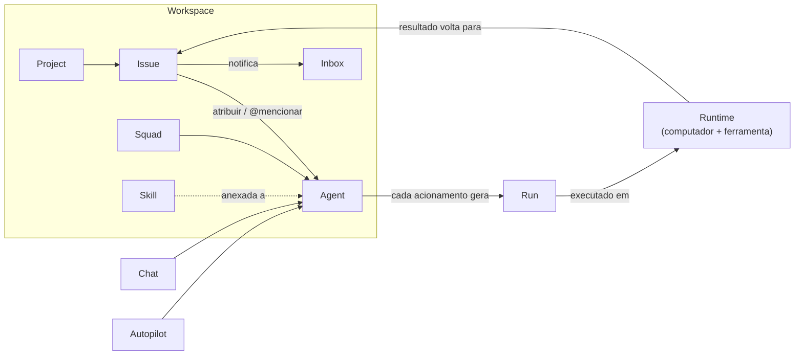

# Sobre o Multica — Agentes como Colegas de Equipe

Esta página explica **por que** o Multica é organizado do jeito que é, e como as peças se encaixam. O passo a passo, com um exemplo guiado de TODO List, está na curiosidade [Orquestração e Observabilidade](../curiosidades/orquestracao-e-observabilidade.md). Os comandos e limites estão na [Referência do Multica](../referencia/multica.md).

---

## A ideia central

Até a Aula 13, o agente de IA era uma ferramenta que **você** abre no terminal: você escreve o pedido, ele executa, você revisa. O trabalho só anda enquanto você está na conversa.

O [Multica](https://multica.ai) muda a posição do agente: ele deixa de ser ferramenta e passa a ser **membro da equipe**. O agente recebe issue, comenta, abre pull request, muda status, pede revisão a outro agente e avisa você no Inbox quando termina. Pessoas e agentes trabalham **no mesmo espaço e com o mesmo vocabulário** — issue, comentário, menção, revisão.

O projeto se apresenta assim no repositório: *"Make humans and AI agents work as one team — open-source and self-hostable."* Ele é de código aberto, escrito em Go, e pode rodar na nuvem do Multica ou em servidor próprio.

!!! abstract "Conexão com o resto do curso"
    É o mesmo movimento do Scrum da EaD 07 e do GitFlow da Aula 07: o trabalho ganha **rastro**. Cada pedido vira issue, cada execução fica registrada, cada mudança passa por PR e revisão. A diferença é que parte dos executores são agentes.

---

## Os conceitos e como se relacionam

A documentação oficial organiza o Multica em três grupos de conceitos.

### Objetos básicos

| Conceito | O que é |
|----------|---------|
| **Workspace** | O escopo fechado onde a equipe trabalha. Tudo — trabalho e configuração — acontece dentro dele. Pessoas e agentes colaboram no mesmo workspace |
| **Issue** | Uma unidade de trabalho, com descrição, discussão, status e histórico. O responsável pode ser uma pessoa, um agente ou uma squad |
| **Project** | Agrupa issues sob um objetivo, acompanha o progresso e pode vincular recursos usados na execução, como repositórios e diretórios |

### Agentes e execução

| Conceito | O que é |
|----------|---------|
| **Agent** | Um colaborador de IA. É uma **configuração reutilizável**: nome, instruções, modelo, skills, acesso e runtime |
| **Skill** | Um pacote reutilizável de capacidade. As instruções dizem **quem** o agente é; a skill diz **como** um tipo de trabalho é feito. O arquivo principal é `SKILL.md` |
| **Runtime** | Onde a execução acontece: um computador conectado ao Multica mais uma ferramenta de código com IA instalada nele, como Claude Code ou Codex |
| **Daemon** | O processo do Multica que roda em segundo plano no computador. Conecta ao servidor, descobre as ferramentas locais, pega runs e devolve resultados |
| **Run** | Um registro concreto de execução. Cada acionamento de um agente gera um run |

### Colaboração e automação

| Conceito | O que é |
|----------|---------|
| **Squad** | Um grupo de agentes e pessoas, liderado por um agente. Atribuir uma issue à squad faz o líder coordenar o trabalho |
| **Chat** | Uma conversa fora de issue. Cada mensagem gera um run |
| **Inbox** | A central de notificações de cada pessoa: menções, atribuições e atividade das issues acompanhadas |
| **Autopilot** | Aciona runs por agenda ou por evento externo. Também pode ser disparado à mão |

### O fluxo completo

Lido em voz alta: **atribuir, mencionar, conversar ou agendar aciona um agente; cada acionamento gera um run; o run executa num runtime e escreve o resultado de volta onde foi acionado.**

---

## Três distinções que evitam confusão

### Agente não é processo — é identidade

> *"An agent is not a long-running process; it executes only when triggered."*

O agente **não fica rodando** esperando trabalho. Ele é uma ficha de configuração. Só executa quando alguém — ou algo — o aciona. Por isso o mesmo agente pode atender várias issues: cada uma gera o próprio run.

### Agente não é runtime

> *"The agent is the identity; the runtime is the computer that executes it."*

O agente **Engineer** é quem assina o trabalho. O runtime é **onde** o trabalho roda: o seu notebook com Claude Code, por exemplo. Se o computador desliga, o agente continua existindo, mas não há onde executar — o runtime aparece como *Offline*.

Um mesmo computador pode oferecer vários runtimes: um por ferramenta instalada, em cada workspace conectado.

### Run concluído não é issue concluída

Uma issue pode gerar muitos runs: o primeiro implementa, outro corrige o que o revisor apontou, outro faz o merge. **Terminar um run não fecha a issue.** O status da issue — *In Progress*, *In Review*, *Done* — é o que diz onde o trabalho está.

!!! tip "Por que isso importa para medir"
    É exatamente a separação do [PSM CID](psm-cid.md) entre **esforço** e **fluxo**. Os runs mostram o esforço gasto; as transições de status da issue mostram o fluxo. Cycle Time se mede na issue, não no run.

---

## Onde ficam os dados

O Multica separa o que fica no servidor do que fica na sua máquina:

| Fica no seu computador | Fica no servidor do Multica |
|------------------------|-----------------------------|
| Credenciais das ferramentas de IA | Issues, comentários e configuração |
| Código local | Contexto e resultado de cada run |

O servidor **não executa comandos** nas ferramentas locais: quem executa é o daemon, no seu computador. O Multica também **não recebe** o login da ferramenta de IA — a credencial fica guardada pela própria ferramenta.

!!! danger "Dois pontos de atenção de segurança"
    - **Variáveis de ambiente de agente ficam em texto puro** no banco do servidor — a documentação diz isso explicitamente. Não coloque segredo de produção ali.
    - **Skills importadas não são revisadas, assinadas nem isoladas.** Uma skill de terceiro é texto que o agente vai obedecer com acesso ao seu computador. Leia antes de importar.

---

## Fontes

- [Concepts](https://multica.ai/docs/concepts) — definição oficial de cada conceito
- [Daemon and runtimes](https://multica.ai/docs/daemon-runtimes) — fronteira de dados, limites e estados do runtime
- [Skills](https://multica.ai/docs/skills) — aviso sobre skills importadas
- [Create an agent](https://multica.ai/docs/agents-create) — campos do agente e variáveis de ambiente
- [multica-ai/multica](https://github.com/multica-ai/multica) — repositório do projeto
